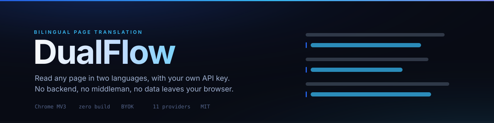

<div align="center">
  
</div>

<br>

<div align="center">

**Read any web page in two languages — with your own API key.**

No backend. No middleman. No subscription. The whole extension is plain ES modules you can read before you install it.

[](#install)
[](#why-zero-build)
[](#privacy--security)
[](#development)
[](LICENSE)

[Features](#features) · [Install](#install) · [Quick start](#quick-start) · [Providers](#supported-providers) · [How it works](#how-it-works) · [Troubleshooting](#troubleshooting)

</div>

---

## Why another translator

Every immersive translation extension either sells you a subscription, routes your page text through someone else's server, or both. You already pay for a model API — DualFlow just uses it.

Point the extension at DeepSeek, OpenAI, Gemini, Claude, a local Ollama instance, or any OpenAI-compatible endpoint. Translations are rendered **in place, right under each paragraph**, styled to sit quietly beside the original text. Nothing about the page leaves your browser except the paragraphs being translated, sent directly to the endpoint you configured.

---

## Features

### Translation quality

| | |
|---|---|
| **In-place bilingual injection** | The translation container is anchored *after* its source paragraph's anchor node, so multiple translated segments coexist without overwriting each other and host `flex` / `grid` layouts survive intact. Marked with a 2 px tech-blue rule and a low-saturation background. |
| **Segment-level splitting** | Locates the block hosting the body text, then splits its direct text by `<br>` and block children. Handles real-world markup like bare text separated by `<br>`, `div.para`, and `div.article_right`. |
| **Navigation and label skipping** | Skips `nav` / menus / breadcrumbs, short labels like `HOME` or `Sign in`, and link-dense blocks made entirely of short words — no wasted tokens, no mangled menus. |
| **Noise filtering** | `<script>` / `<style>` / `<pre>` / `<code>` / `<svg>` never enter the queue, so inlined JS is not sent to the model as prose. |
| **Zero-cost CJK passthrough** | Pure-Chinese paragraphs are released in 0 ms without any API call. Japanese kana and Korean hangul are detected separately so they are not mistaken for Chinese. |
| **Batch and concurrency control** | Dual circuit breaker on segment count and character budget; per-model concurrency semaphore; exponential backoff with jitter on 429 / 503. |
| **Fault tolerance** | 15-second hard timeout, Markdown fence stripping, automatic repair of truncated JSON, and a bisect-and-resend fallback when a whole batch fails to parse. |
| **Dynamic page support** | `IntersectionObserver` lazy-loads off-screen paragraphs; `MutationObserver` with a 300 ms debounce rescans for new content. Self-mounted nodes are excluded, so there is no feedback loop. |
| **Lossless revert** | One click removes every `.flow-translate-container` and `data-df-*` marker — the DOM returns to its original state. |

### Configuration

| | |
|---|---|
| **11 provider presets** | DeepSeek · OpenAI · Gemini · Claude · SiliconFlow · Moonshot/Kimi · Alibaba Bailian/Qwen · Zhipu GLM · Ollama · LM Studio · custom compatible endpoint |
| **Smart endpoint assembly** | Missing `/v1` is added automatically, complete paths are not double-joined, and a full-endpoint override is available. The popup and options page always show the **actual request URL**. |
| **Four-layer self-check** | Config → endpoint assembly → connectivity ping → response parsing, each with a concrete fix suggestion. |
| **Protocol adaptation** | OpenAI-compatible `/chat/completions`, Anthropic native `/messages`, Gemini native `:generateContent`. |
| **Hot model switching** | Change the active model in the popup; the next batch uses it immediately, no page reload. |
| **Translate modes** | `manual` (default, click the toggle per page) · `always on` (translate every page automatically) · `always off`. Per-site exclusions always take priority. |

> The extension UI is in Chinese. The code and this README are in English.

---

## Install

### From source (recommended — no build step)

```bash
git clone https://github.com/13734795725zhao-rgb/dualflow-translator.git
```

1. Open `chrome://extensions/`
2. Turn on **Developer mode** (top right)
3. Click **Load unpacked** and select the repository root — the folder containing `manifest.json`
4. Pin the extension to the toolbar (puzzle icon → pin)

Works the same in Edge, Brave, Arc, and any other Chromium browser. Default shortcut is <kbd>Alt</kbd>+<kbd>T</kbd>; change it at `chrome://extensions/shortcuts`.

### From a release package

Download the `.zip` from [Releases](https://github.com/13734795725zhao-rgb/dualflow-translator/releases), unzip it, then **Load unpacked** the extracted folder.

> Chrome 137+ restricts local `.crx` installation. Prefer loading the unpacked directory, or upload the zip to the Chrome Web Store.

---

## Quick start

1. Click the extension icon → <kbd>⚙</kbd> to open **Options**
2. **Model registry → + Add provider** → pick a preset (e.g. DeepSeek) → paste your API key → save
3. Under the provider card, **+ Add model** (preset model names are pre-filled) → save
4. Back in the popup, select the model under **Active model**, then choose a translate mode:

| Mode | Behaviour |
|---|---|
| **Manual** (default) | You toggle translation on each page — no accidental API spend |
| **Always on** | Every page translates on load. Costs quota on every site you visit |
| **Always off** | Nothing auto-translates; the per-page toggle still works |

Translations appear directly beneath each paragraph. Hover a translation to **copy** it or **hide that sentence**; failed paragraphs show a pale red **Retry** strip.

---

## Supported providers

| Provider | Protocol | Default endpoint |
|---|---|---|
| DeepSeek | OpenAI | `api.deepseek.com/v1` |
| OpenAI | OpenAI | `api.openai.com/v1` |
| Google Gemini | Gemini native | `generativelanguage.googleapis.com/v1beta` |
| Anthropic Claude | Anthropic native | `api.anthropic.com` |
| SiliconFlow | OpenAI | `api.siliconflow.cn/v1` |
| Moonshot / Kimi | OpenAI | `api.moonshot.cn/v1` |
| Alibaba Bailian / Qwen | OpenAI | `dashscope.aliyuncs.com/compatible-mode/v1` |
| Zhipu GLM | OpenAI | `open.bigmodel.cn/api/paas/v4` |
| Ollama | OpenAI | `localhost:11434/v1` |
| LM Studio | OpenAI | `localhost:1234/v1` |
| Custom | OpenAI | any compatible base URL |

Presets live in [`src/shared/providers.js`](src/shared/providers.js) — adding a provider is a data edit, not a code change.

---

## How it works

```
 Page (content script, classic scripts sharing the DF namespace)
   │  collect segments → CJK filter → batch → Port message
   ▼
 Service Worker (background, ES module)
   │  chunk by count + character budget
   │  per-model semaphore → fetch → parse with repair
   │  exponential backoff on 429/503
   ▼
 Your endpoint (OpenAI / Anthropic / Gemini)
   │
   ▼
 content script  →  render translation under its anchor  →  SSE-free batch write
```

Requests originate in the **Service Worker**, not the content script, so page CSP cannot block them. Endpoint, key and headers live only in `chrome.storage.local`.

```
manifest.json                  MV3 manifest: permissions, content scripts, service worker, hotkey
icons/                         16 / 48 / 128 px
src/
├── shared/                    cross-context layer
│   ├── constants.js           status enums, message actions, defaults, block-lists
│   ├── messages.js            Port channel contract with a uniform envelope
│   ├── providers.js           provider presets, base URL normalisation, key masking
│   ├── types/storage.js       ProviderConfig / ModelRegistry / DomainRule / AppSettings
│   └── storage/
│       ├── migration.js       schema version checks and field patching
│       └── storage-client.js  in-memory snapshot + onChanged + CRUD + domain matching
├── background/                service worker pipeline
│   ├── index.js               port handling, batching, error mapping, config broadcast
│   ├── pipeline/chunker.js    dual circuit breaker (count + character budget)
│   ├── pipeline/scheduler.js  concurrency semaphore + jittered exponential backoff
│   └── client/llm-client.js   request assembly for 3 protocols + tolerant JSON parsing
├── content/                   DOM execution layer
│   ├── content.js             orchestration: config, buffering, port comms, render, stats
│   ├── filter/cjk-detector.js 0 ms CJK purity check, plus kana and hangul detection
│   ├── ingestion/dom-observer.js  TreeWalker-style collection, viewport lazy load, debounce
│   ├── render/in-place-renderer.js skeleton / translated / retry states, copy, hide, revert
│   └── style.css              strongly isolated injected styles, light and dark
├── popup/                     360×480 quick control panel
└── options/                   model registry, filters, site rules, appearance
scripts/
├── check.mjs                  offline self-check: syntax, manifest, unit tests, DOM ids
├── mock-test.mjs              pipeline integration test against mocked chrome.* and fetch
├── build.mjs                  package: dist folder + ZIP + self-signed CRX3 + SHA256
└── verify-package.mjs         verify ZIP layout, CRX3 signature, assets, checksums
```

### Message protocol

| Action | Direction | Purpose |
|---|---|---|
| `REQ_BATCH_TRANSLATE` | content → worker | Send a batch over a long-lived Port |
| `RESP_BATCH_TRANSLATE` | worker → content | Return `{seqId, translatedText, error, errorCode}` |
| `REQ_TEST_CONNECTION` | options → worker | Ping probe returning latency |
| `EVENT_CONFIG_CHANGED` | popup/options → worker → content | Hot config broadcast |
| `CMD_START_TRANSLATION` / `CMD_SWEEP_TRANSLATION` | popup/hotkey → content | Translate / revert |
| `REQ_TAB_STATS` / `RESP_TAB_STATS` | popup → content | Per-page counters |

---

## Privacy & security

- API key, base URL and headers live **only** in `chrome.storage.local`. Nothing is uploaded anywhere else.
- Every model request is issued **directly** by the service worker to the endpoint you configured. There is no relay, no telemetry, no analytics SDK in the extension.
- Logs and error messages pass through a redaction middleware that strips `Bearer`, `sk-` and `key=` credentials before they reach the console.
- Minimal permissions: `storage` + `activeTab`, plus `host_permissions` needed to reach model endpoints.

---

## Development

No dependencies, no bundler — open the folder and the source is the running code.

```bash
npm run check        # static self-check
npm run test:mock    # pipeline integration test
npm run build        # package dist + ZIP + CRX3 + SHA256
npm run release      # check → mock → build → verify
```

`check.mjs` covers JS syntax across all files, manifest and asset existence, ten CJK filter UAT cases, tolerant JSON parsing, batch chunking, DOM id consistency, navigation-label filtering, and text-segment splitting for bare-text-plus-`<br>` structures.

`mock-test.mjs` drives the real background pipeline against a mocked `chrome.*` and `fetch`, verifying storage read → model activation → chunking → request assembly for all three protocols → response extraction → result write-back, including the bisect-and-resend path for truncated batches.

### Design decisions worth knowing

The original specification this project implements proposed a different stack in several places. These are deliberate departures:

| Topic | Spec said | This implementation | Why |
|---|---|---|---|
| Build chain | TypeScript + Vite + @crxjs | Native ES modules, zero build | No `npm install`, load-unpacked just works, and the source you audit is the code that runs |
| CJK purity denominator | Han ÷ all valid characters | Han ÷ (Han + foreign word count), plus kana/hangul detection | The original formula failed its own UAT cases — pure Japanese was classified as Chinese, Chinese-dominant mixed text as foreign |
| Node selection | Collect all block siblings | Only the innermost semantic node | Prevents `li > p`, `td > p` structures translating the same sentence twice |
| Protocols | OpenAI-compatible only | Added Anthropic and Gemini native | Claude and Gemini presets are not OpenAI-protocol endpoints |
| Streaming | Streaming responses | Non-streaming batches | Translations are written back per parsed segment; streaming added parsing complexity with no user-visible gain |

---

## Troubleshooting

**The model is slow, but it never shows a skeleton?** Then the problem is the link, not the model. A slow model still renders skeleton placeholders first.

| Symptom | Root cause | What this extension does |
|---|---|---|
| Request never leaves | `fetch` in the content script blocked by page CSP | All requests run in the service worker; `host_permissions` covers both schemes |
| 404 | Base URL missing `/v1`, or `/chat/completions` double-joined | Smart assembly, plus a full-endpoint override |
| 401 / 403 | Invalid key or no access to that model | Error text names the cause directly |
| Page does nothing | Old tab has no content script | The popup offers **Reload page and translate** |
| HTTP 200 but nothing renders | Markdown fences or truncated JSON | Parser strips fences, repairs truncated arrays, falls back to regex extraction |

**Four-layer self-check:** Options → Model registry → **Start self-check**. All four green means the config and API are fine and the problem is on the page side.

The service worker logs the **actual request URL** on every call, with credentials redacted:

```
[DualFlow] actual request URL: https://api.deepseek.com/v1/chat/completions | protocol=openai | model=deepseek-chat
```

---

## Limitations

- Top-level document only — no iframe injection (enable `all_frames` in `manifest.json` if you need it).
- Translations are written after the whole JSON batch parses, so very long paragraphs do not stream character by character.
- Off-screen paragraphs are lazy-loaded and translate when scrolled into view.
- No PDF or EPUB support — binary document formats are out of scope by design.

---

## Documentation

| Document | Contents |
|---|---|
| [`docs/README.zh-CN.md`](docs/README.zh-CN.md) | Full Chinese documentation — feature tables, message protocol, detailed troubleshooting |

---

## Contributing

Issues and pull requests are welcome.

- Keep it zero-build: no bundler, no `node_modules`, no transpilation step.
- Run `npm run check` and `npm run test:mock` before opening a PR.
- New providers go in `src/shared/providers.js`.
- Never commit `dist/` or `.keys/` — the latter holds the CRX signing key.

---

## License

[MIT](LICENSE) © 2026 幻蝶

---

<div align="center">
<sub>Your key. Your quota. Your page.</sub>
</div>
